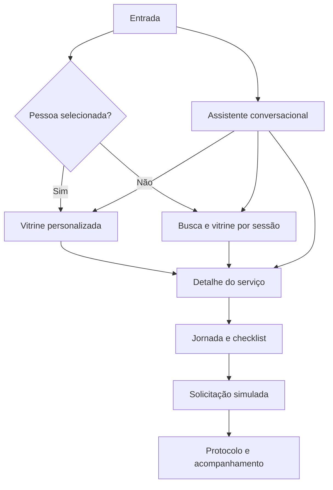

# Implementação do Conecta Recife no Kodiak

Este documento transforma os recursos do backend em telas, componentes e comportamentos do Kodiak. O Swagger é a referência de campos e respostas HTTP.

- Swagger: `http://localhost:8080/swagger-ui/index.html`
- OpenAPI JSON: `http://localhost:8080/v3/api-docs`
- Guia HTTP: [integracao-front.md](integracao-front.md)

## Fluxo principal



O assistente, a busca e a vitrine ficam disponíveis desde a entrada. A pessoa não precisa conhecer o nome exato de um serviço ou a tela correta.

## Mapa de telas e integrações

| Tela ou componente | O que implementa | Endpoint ou recurso |
| --- | --- | --- |
| Entrada e personas | Seleção de persona ou ID para a demo | `GET /cidadaos/{id}` |
| Vitrine | Até 10 cards personalizados com motivo | `GET /cidadaos/{id}/recomendacoes` |
| Busca | Texto, resultado vazio e cards de serviço | `GET /servicos/busca?q=` |
| Microfone e leitor | Fala para texto e texto para fala | APIs de voz do navegador |
| Assistente | Chat, cards e ações sugeridas | `POST /assistente/conversar` |
| Sem login | Cards com contexto da sessão | `GET /anonimo/recomendacoes?acessados=` |
| Detalhe | Informações do catálogo e CTA | `GET /servicos/{id}` |
| Jornada | Requisitos e passos | `GET /servicos/{id}/jornada` |
| Checklist | Progresso informado pela pessoa | `POST /servicos/{id}/jornada/progresso` |
| Preferências | Consentimento e notificações | `GET` e `PUT /preferencias` |
| Solicitação | Confirmação de envio | `POST /solicitacoes` |
| Acompanhamento | Protocolo e linha do tempo | `GET /solicitacoes/{protocolo}` |
| Métricas | Funil da demonstração | `POST /eventos`, `GET /metricas` |
| Administração | Exportar e validar CSV | `/recomendacoes.csv`, `/recomendacoes/validar` |

## Estado no frontend

```ts
type SessaoConecta = {
  apiUrl: string
  cidadao?: { id: string; dados: Cidadao }
  recomendacoes: Recomendacao[]
  acessadosSemLogin: number[]
  conversa: MensagemChat[]
  protocolos: string[]
  jornadaAtual?: { servicoId: number; concluidos: number[] }
}
```

| Estado | Onde manter | Regra |
| --- | --- | --- |
| Cidadão, vitrine e jornada | Estado da aplicação | Limpar ao trocar de pessoa. |
| Serviços sem login | Memória ou `sessionStorage` | Limpar na nova sessão, limite de 50 IDs. |
| Conversa | Estado visual | A API não mantém histórico. |
| Checklist | Estado da jornada | Enviar sempre a lista completa de posições. |
| Protocolo | Estado ou `sessionStorage` | Pode desaparecer se a API reiniciar. |

Não armazenar dados pessoais reais, áudio bruto ou inferências sobre uma pessoa.

## Entrada e vitrine personalizada

Ofereçam as oito personas oficiais e um campo de ID. Para selecionar:

1. `GET /cidadaos/{id}`.
2. Guardar o cidadão no estado.
3. `GET /cidadaos/{id}/recomendacoes`.
4. Navegar à vitrine.

Comecem a demo com `C007938` e comparem com `C068579`. Cada card precisa ter nome, motivo, CTA “Ver serviço” e, se houver espaço, órgão ou tema. Ao abrir, enviem `ABRIU` na etapa `detalhes`, chamem `GET /servicos/{id}` e renderizem o detalhe.

Não mostrar “você tem direito a”. Recomendação só indica relevância. Requisitos e condições vêm da jornada.

## Busca, voz e leitura

### Busca digitada

Chamar `GET /servicos/busca?q={texto}` depois de cerca de 250 ms sem digitação. Cancelar busca anterior se houver nova digitação. Consulta vazia não chama a API. Sem resultado, mostrar “Não encontramos um serviço com esse termo. Tente outra busca.”

### Busca por voz

1. Botão de microfone pede permissão e mostra “Ouvindo…”.
2. Usar reconhecimento do navegador em `pt-BR`.
3. Mostrar transcrição parcial no campo de busca.
4. Ao finalizar, permitir revisão e disparar a busca normal.
5. Oferecer cancelar.

Se voz não for suportada ou houver negação de microfone, manter a busca por texto. Não enviar ou salvar gravação de áudio.

### Resposta falada

Para cada resultado, assistente ou recomendação, oferecer “Ouvir resposta”. Ler uma frase curta, como “Encontrei o serviço X. Y”. Sempre manter texto na tela. Nunca iniciar áudio automaticamente. Ter botão de parar e rótulo acessível.

## Assistente conversacional

O assistente deve ser um painel expansível na entrada e na busca, sem bloquear a navegação.

```http
POST /assistente/conversar
Content-Type: application/json

{
  "mensagem": "Quero marcar uma consulta",
  "cidadaoId": "C007938"
}
```

`cidadaoId` é opcional. O retorno traz `mensagem`, `servicos`, `acoes` e `avisos`.

```json
{
  "mensagem": "Encontrei estes serviços no catálogo.",
  "servicos": [{
    "servicoId": 120,
    "nome": "Agendar consulta no CEREST para trabalhador do Recife",
    "motivo": "Serviço encontrado no catálogo"
  }],
  "acoes": [{
    "tipo": "BUSCAR",
    "rotulo": "Ver resultados da busca",
    "caminho": "/servicos/busca"
  }],
  "avisos": []
}
```

Renderizem `mensagem` como balão de chat e opcionalmente com leitura por voz. `servicos` viram cards clicáveis. `acoes` viram CTAs. `avisos` são texto de contexto, sem aparência de erro. O frontend mantém o histórico visual, mas cada mensagem enviada é independente para a API.

Ele responde sobre serviços, jornada, protocolo, consentimento, sugestões e novidades. Com cidadão selecionado e pedido de sugestão, usa a vitrine daquele cidadão. Sem cidadão, usa somente catálogo. Não apresentar resposta como confirmação de elegibilidade ou orientação jurídica, médica ou de benefício.

Mensagem vazia ou maior que 500 caracteres retorna 400. Cidadão inexistente retorna 404. Preservar o texto digitado em caso de erro.

## Experiência sem login

Não criar aba adicional. Sem cidadão selecionado, cada serviço aberto entra em `acessadosSemLogin`.

```ts
const acessados = [...new Set([...sessao.acessadosSemLogin, servicoId])].slice(-50)
```

Depois, chamar:

```text
GET /anonimo/recomendacoes?acessados=458,1359
```

Renderizar como cards da vitrine. `transicoesDisponiveis=false` não bloqueia a experiência. Não cachear para outra sessão, pois a resposta vem com `Cache-Control: no-store`. Não inferir Bolsa Família, renda, saúde, perfil ou elegibilidade a partir da navegação.

## Serviço, jornada e checklist

`GET /servicos/{id}` entrega detalhes. `GET /servicos/{id}/jornada` entrega `requisitos` e `passos` como listas.

Renderizar passos integralmente, com checkboxes. Ao mudar, enviar a lista completa das posições marcadas:

```http
POST /servicos/1/jornada/progresso
Content-Type: application/json

[1, 2]
```

Usar a resposta para atualizar o checklist, texto “2 de 4 etapas marcadas por você” e barra de `percentual`. Mostrar que `autodeclarado: true` significa marcação da pessoa, sem confirmação pelo órgão. Não usar pontos, medalhas ou recompensas.

Ao abrir a jornada, registrar `ABRIU` em `documentos`. Quando a pessoa começar, `INICIOU`. Ao concluir o envio, `CONCLUIU`. Em desistência explícita, `ABANDONOU`.

## Solicitação e acompanhamento

```http
POST /solicitacoes
Content-Type: application/json
Idempotency-Key: UUID-gerado-no-clique

{
  "cidadaoId": "C007938",
  "servicoId": 1
}
```

Desabilitar o botão durante o envio. Em falha de rede, “Tentar novamente” reutiliza mesma chave e mesmo corpo. O retorno 201 contém protocolo, status, linha do tempo e `simulada`. Após criar, consultar `GET /solicitacoes/{protocolo}` a cada 10 segundos. Parar ao chegar em `CONCLUIDA` ou sair da tela.

## Consentimento e notificações

Ao abrir configurações, chamar `GET /preferencias?cidadaoId={id}`. Usar dois controles:

- “Usar sinais de saúde para personalizar sugestões”;
- “Receber notificações”.

Salvar com `PUT /preferencias`:

```json
{
  "cidadaoId": "C007938",
  "consentimentoSaude": true,
  "aceitaNotificacao": false
}
```

Recarregar a vitrine após salvar. Não citar diagnósticos nos motivos ou notificações.

## Eventos e métricas

| Interação | `etapa` | Evento |
| --- | --- | --- |
| Abriu detalhes | `detalhes` | `ABRIU` |
| Começou jornada | `documentos` | `ABRIU`, depois `INICIOU` |
| Enviou solicitação | `solicitacao` | `ABRIU`, `INICIOU`, `CONCLUIU` |
| Desistiu explicitamente | Etapa atual | `ABANDONOU` |

```json
{
  "eventoId": "uuid-da-acao",
  "jornadaId": "uuid-da-tentativa",
  "cidadaoId": "C007938",
  "servicoId": 1,
  "etapa": "detalhes",
  "tipo": "ABRIU"
}
```

`eventoId` é único por ação. `jornadaId` identifica uma tentativa. Em reenvio por falha, usar o mesmo corpo. `GET /metricas` retorna as taxas de 0 a 1, que podem ser exibidas como `taxaConclusao * 100` e `taxaAbandono * 100`.

## Ferramentas administrativas

| Função | Implementação |
| --- | --- |
| Exportar arquivo final | Link para `GET /recomendacoes.csv`. Avisar que pode demorar e é grande. |
| Validar CSV | Enviar `FormData` no campo `arquivo` para `POST /recomendacoes/validar`. Não definir manualmente o header multipart. |
| Painel de demo | Consultar `GET /metricas`. |

## Acessibilidade e falhas

- Interface móvel em uma coluna, controles grandes, contraste e foco visível.
- Ícones precisam de rótulo acessível. Microfone: “Buscar por voz”. Alto-falante: “Ouvir resposta”.
- Progresso sempre com texto e percentual, além de cor.
- Usar `aria-live="polite"` para resposta do assistente, protocolo e atualizações relevantes.
- 400: mostrar `detail` e permitir correção. 404: voltar à seleção ou busca. 409: manter estado e mostrar `detail`. Falha de rede: oferecer nova tentativa.
- Após reinício da API, explicar que preferências, protocolos e métricas da demo foram reiniciados.

## Roteiro de aceitação

1. Selecionar `C007938` e carregar vitrine.
2. Comparar com `C068579`.
3. Buscar “quero marcar médico” por texto e voz, quando disponível.
4. Perguntar ao assistente “quais são as novidades?” e “quero marcar uma consulta”.
5. Abrir jornada, marcar passos e conferir percentual.
6. Alterar consentimento e recarregar vitrine.
7. Criar solicitação, mostrar protocolo e acompanhar mudança de status.
8. Consultar métricas após eventos.
9. Repetir sem cidadão selecionado, usando busca e recomendações por sessão.
10. Testar celular, teclado, leitor de tela e busca sem resultado.

## Publicação para a demo

Definir `API_URL` no frontend. Em máquinas diferentes, `localhost` não conecta front e backend. Usar URLs HTTPS acessíveis e configurar `APP_CORS_ALLOWED_ORIGINS` com a origem exata do Kodiak. O plano B é executar frontend e API na mesma máquina, com os dados locais preparados e Swagger aberto em outra aba.
